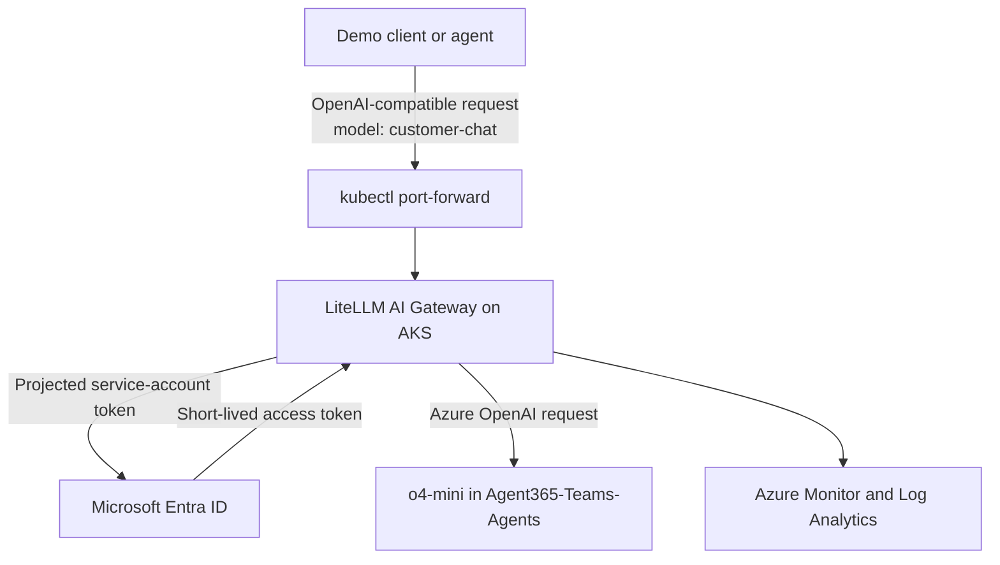
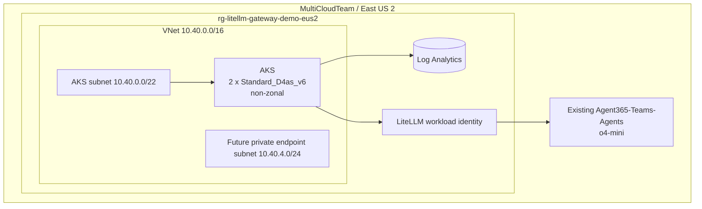
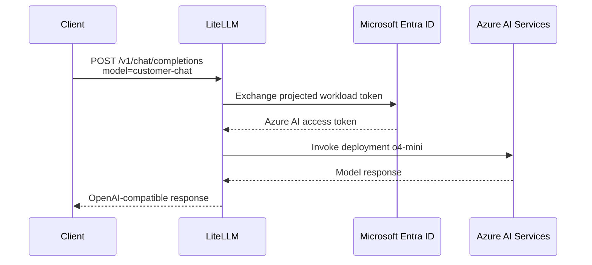
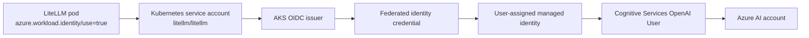
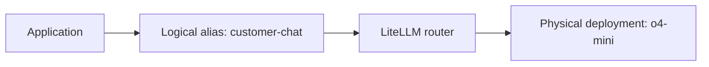
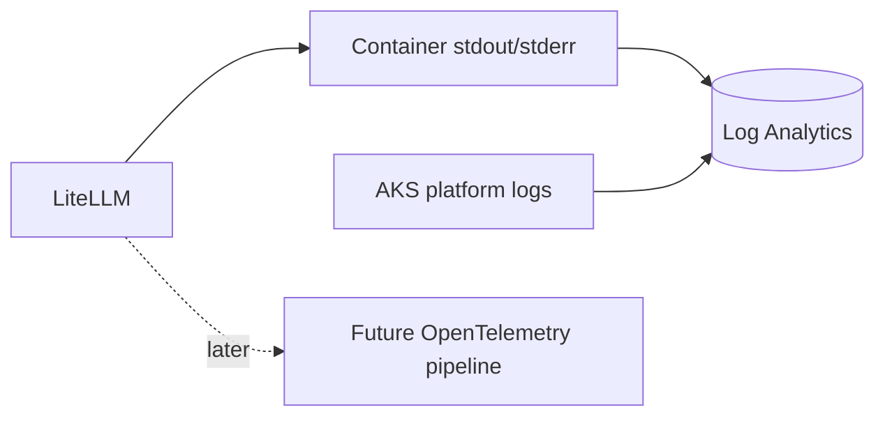
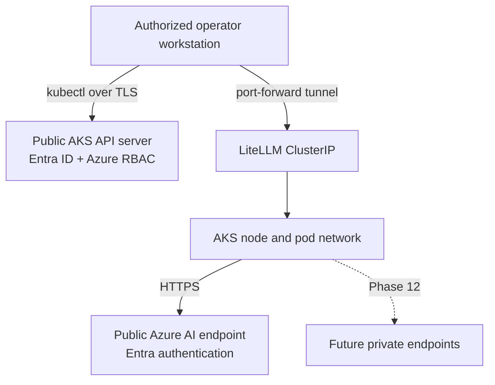

# Architecture

## High-Level Architecture

The first deployment intentionally has no public gateway endpoint. Customer-facing HTTPS ingress is added only after DNS and certificate ownership are known.

## Azure Infrastructure

## Request Flow

## Identity Flow

## Model Routing

The client does not receive or need the Azure deployment name.

## Observability

Phase 1 enables the AKS monitoring baseline. LiteLLM-specific metrics and OpenTelemetry integration are introduced only after their current supported configuration is validated.

## Network Boundaries

The public AKS API server is a Day-0 simplification, not an anonymous endpoint. Kubernetes local accounts are disabled and access requires Microsoft Entra ID plus Azure RBAC.
