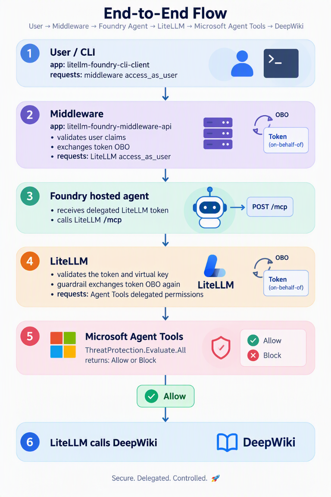
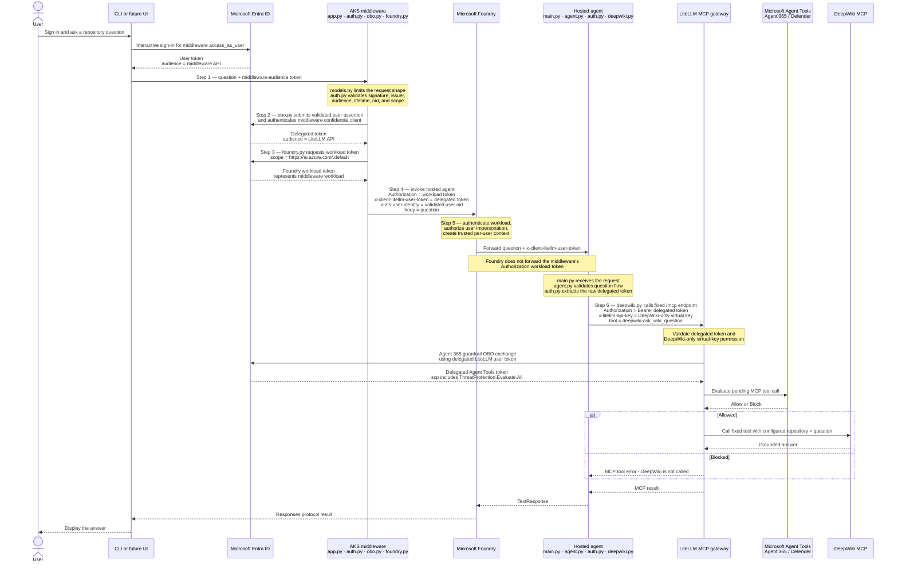
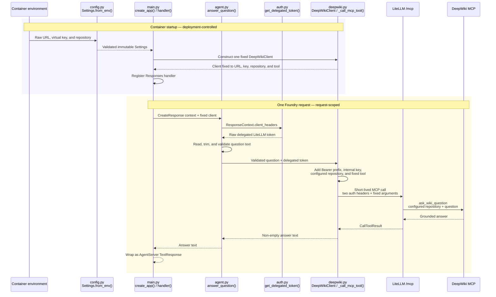

# Foundry delegated access: concept-to-code diagrams

These diagrams introduce the solution before the reader opens the Python
implementation. They adapt Microsoft's six-step
[application-managed OBO and token-forwarding flow](https://learn.microsoft.com/en-us/azure/foundry/agents/how-to/use-on-behalf-of-flow#understand-the-delegated-access-flow)
to this repository's LiteLLM and DeepWiki scenario.

The diagrams are intentionally separate:

1. **Delegated token flow** explains what the user experiences and how each
   identity or token moves between services.
2. **Hosted-agent code flow** explains how the Python files collaborate after
   Foundry delivers a request to the container.

Standalone high-resolution PNGs are available for presentations and documents:

- [Download the delegated token-flow PNG](./diagrams/foundry-obo-token-flow.png)
  (`4768 × 2630`)
- [Download the hosted-agent code-flow PNG](./diagrams/hosted-agent-code-flow.png)
  (`4502 × 2782`)
- [Download the Agent Tools end-to-end token-flow PNG](./diagrams/agent-tools-end-to-end-token-flow.png)
  (`768 × 1152`)

The following compact view includes the additional Agent 365 evaluation hop
that occurs after the hosted agent reaches LiteLLM:



## 1. User interaction and delegated token flow



### What the user sees

The user performs only two visible actions:

1. Sign in through the client.
2. Ask a question and receive an answer.

The OBO exchange, workload authentication, header forwarding, LiteLLM
authorization, and DeepWiki call happen between trusted backend components.
The client never receives the middleware OBO secret or the LiteLLM virtual
key.

### Microsoft steps mapped to this repository

| Microsoft delegated-access step | This implementation | Primary files |
| --- | --- | --- |
| 1. Authenticate the user | The client sends a middleware-audience token. The middleware accepts only question text, validates the token, and derives the trusted user object ID. | [`middleware/src/foundry_middleware/models.py`](../middleware/src/foundry_middleware/models.py), [`app.py`](../middleware/src/foundry_middleware/app.py), [`auth.py`](../middleware/src/foundry_middleware/auth.py) |
| 2. Exchange the user token | The middleware confidential client submits the validated token as the OBO assertion and requests LiteLLM's delegated `access_as_user` scope. | [`middleware/src/foundry_middleware/obo.py`](../middleware/src/foundry_middleware/obo.py) |
| 3. Authenticate to Foundry separately | AKS Workload Identity obtains a `https://ai.azure.com/.default` token. This is separate from the user's LiteLLM token. | [`middleware/src/foundry_middleware/foundry.py`](../middleware/src/foundry_middleware/foundry.py) |
| 4. Send tokens and user context | The middleware sends the Foundry workload token, raw delegated LiteLLM token, validated `oid`, and question. | [`middleware/src/foundry_middleware/foundry.py`](../middleware/src/foundry_middleware/foundry.py), [`app.py`](../middleware/src/foundry_middleware/app.py) |
| 5. Resolve and forward the request | Foundry authenticates the workload and forwards only the `x-client-*` token header and request body to the hosted container. | Foundry platform plus [`main.py`](../litellm-deepwiki-agent/src/litellm-deepwiki-agent/main.py) |
| 6. Call the downstream API | The hosted agent reads the raw delegated token, adds `Bearer`, combines it with the restricted virtual key, and calls the fixed LiteLLM MCP tool. | [`agent.py`](../litellm-deepwiki-agent/src/litellm-deepwiki-agent/agent.py), [`auth.py`](../litellm-deepwiki-agent/src/litellm-deepwiki-agent/auth.py), [`deepwiki.py`](../litellm-deepwiki-agent/src/litellm-deepwiki-agent/deepwiki.py) |

### The three Foundry request values

These values travel together on the middleware-to-Foundry request but solve
different problems:

| Value | Represents | Forwarded to hosted-agent code? | Used by |
| --- | --- | --- | --- |
| `Authorization: Bearer <Foundry workload token>` | The AKS middleware workload | No | Foundry authenticates the immediate caller |
| `x-client-litellm-user-token: <raw delegated token>` | The signed-in user's delegated LiteLLM permission | Yes | Hosted agent adds `Bearer`; LiteLLM and the Agent 365 guardrail enforce it |
| `x-ms-user-identity: <validated oid>` | The represented user's object ID | Resolved into trusted Foundry request context | Foundry establishes per-user isolation; it is not a downstream access token |

The hosted agent adds a fourth credential only on its outbound LiteLLM call:
the internal `x-litellm-api-key`. That key represents the application and is
restricted to the `deepwiki` MCP server. It never comes from the user or
middleware request.

### Observed Entra sign-in sequence

The Defender `NonInteractiveUserSignInLogs` evidence for this deployment
separates into three delegated token-acquisition legs:

| Client application | Target resource | Important token claims | Repository boundary |
| --- | --- | --- | --- |
| `litellm-foundry-cli-client` (`ff46988d-29af-44ca-8b66-f252e5f5388f`) | `litellm-foundry-middleware-api` (`ec62ae2b-7954-482f-b89a-7b03c29fc7d5`) | `aud` identifies the middleware API; `scp` contains `access_as_user`; `oid` identifies the user | The client obtains the token; [`auth.py`](../middleware/src/foundry_middleware/auth.py) validates it |
| `litellm-foundry-middleware-api` | `litellm` (`18f77e7f-8bf9-4f43-b014-e2168b6c5574`) | A new `aud` identifies LiteLLM; `scp` again contains `access_as_user`; the represented user's `oid` is preserved | [`obo.py`](../middleware/src/foundry_middleware/obo.py) performs OBO; [`foundry.py`](../middleware/src/foundry_middleware/foundry.py) forwards the token |
| `litellm` | Microsoft `Agent Tools` (`ea9ffc3e-8a23-4a7d-836d-234d7c7565c1`) | `aud` identifies Agent Tools; `scp` includes `ThreatProtection.Evaluate.All` and any other consented Agent Tools delegated permissions | LiteLLM's installed `agent_365` guardrail performs this OBO exchange; this repository enables it in [`litellm/config.yaml`](../litellm/config.yaml) |

These rows record token acquisitions, not individual MCP requests. MSAL and
LiteLLM cache OBO tokens, so row counts and timestamps do not need to align
one-for-one with tool-call logs.

The AKS middleware's separate Workload Identity token for
`https://ai.azure.com/.default` is not part of this user-delegation table. It
authenticates the middleware workload to Foundry and is normally found in the
corresponding service-principal or workload-identity sign-in data.

For the exact OIDC federation chain and the distinction between Kubernetes
RBAC, Workload Identity authentication, Azure RBAC, and Entra delegated API
permissions, see
[AKS Workload Identity Federation](./foundry-middleware.md#aks-workload-identity-federation).

### Where Microsoft Agent Tools exists in this codebase

`Agent Tools` is a Microsoft-owned API resource, not a local Python class or
Kubernetes service. The repository activates the integration through:

```yaml
guardrails:
  - guardrail_name: agent365-mcp
    litellm_params:
      guardrail: agent_365
      mode: pre_mcp_call
      default_on: true
```

LiteLLM's installed guardrail implementation reads the delegated user token
from `Authorization`, exchanges it OBO for an Agent Tools token, and submits
the pending MCP server, tool, and arguments for evaluation. Only an **Allow**
result permits the DeepWiki call. A **Block** result returns an MCP error and
DeepWiki is never contacted.

For this runtime path, `ThreatProtection.Evaluate.All` is the permission that
authorizes the evaluation. Other Agent Tools scopes in the token, such as MCP
server listing or publishing permissions, indicate additional delegated
consent—typically for Tools Gateway discovery and management. Their presence
does not mean the DeepWiki request exercised every permission.

The OBO client is the existing dual-role `litellm` app registration, not a
hidden identity created by the LiteLLM software. For its identifier URI,
consented Agent Tools scopes, Kubernetes credential injection, and the Entra
checks performed during token issuance, see
[How LiteLLM Is Authorized for the Second OBO Exchange](./agent365-mcp-guardrail.md#how-litellm-is-authorized-for-the-second-obo-exchange).

### Claims and sign-in metadata

| Field | Role in this flow |
| --- | --- |
| `aud` | Names the API allowed to accept that token; it changes at each OBO boundary |
| `scp` | Lists delegated operations the client may perform as the represented user |
| `oid` | Stable Entra object ID of the represented user |
| `sub` | User subject scoped to the target application |
| `tid` | Tenant that issued the token |
| `appid` or `azp` | Client application that requested the token |
| `iss` | Entra issuer whose signature and tenant are trusted |
| `exp` and `nbf` | Token validity window |
| Sign-in-log `Agent` value | Classification metadata, not an authorization claim consumed by this code |

The observed sign-in-log classification
`{"agentType":"notAgentic","agentSubjectType":"notAgentic"}` is expected. The
CLI, middleware, and LiteLLM are conventional public or confidential
applications performing delegated user OBO. No repository code reads those
classification fields, and they do not disable the Agent 365 evaluation. The
Agent Tools audience and `ThreatProtection.Evaluate.All` scope are the evidence
that the Microsoft evaluation boundary participated.

## 2. Hosted-agent file and data flow



### File responsibilities at a glance

| File | Receives | Produces | Must never do |
| --- | --- | --- | --- |
| [`main.py`](../litellm-deepwiki-agent/src/litellm-deepwiki-agent/main.py) | Validated settings at startup; Foundry `CreateResponse` and `ResponseContext` per request | Configured AgentServer host and `TextResponse` | Perform OBO or accept caller-selected destinations |
| [`config.py`](../litellm-deepwiki-agent/src/litellm-deepwiki-agent/config.py) | Deployment environment variables | Immutable validated `Settings` | Echo the virtual key in errors |
| [`agent.py`](../litellm-deepwiki-agent/src/litellm-deepwiki-agent/agent.py) | Request context and fixed `DeepWikiClient` | Validated question plus answer text | Accept a repository, URL, tool, key, or outbound header from the caller |
| [`auth.py`](../litellm-deepwiki-agent/src/litellm-deepwiki-agent/auth.py) | `ResponseContext.client_headers` | Raw delegated LiteLLM token | Decode, log, persist, or accept a different authorization header |
| [`deepwiki.py`](../litellm-deepwiki-agent/src/litellm-deepwiki-agent/deepwiki.py) | Validated question, delegated token, and deployment-fixed settings | MCP call and non-empty answer text | Return upstream exception text that might contain credentials |

## Reading order

For a customer walkthrough:

1. Start with the first diagram and explain that the middleware owns OBO while
   Foundry owns workload authentication and trusted user context.
2. Emphasize that the workload token, delegated token, and user object ID are
   different values.
3. Use the second diagram to transition from architecture to implementation.
4. Read the code in this order:
   [`main.py`](../litellm-deepwiki-agent/src/litellm-deepwiki-agent/main.py) →
   [`config.py`](../litellm-deepwiki-agent/src/litellm-deepwiki-agent/config.py) →
   [`agent.py`](../litellm-deepwiki-agent/src/litellm-deepwiki-agent/agent.py) →
   [`auth.py`](../litellm-deepwiki-agent/src/litellm-deepwiki-agent/auth.py) →
   [`deepwiki.py`](../litellm-deepwiki-agent/src/litellm-deepwiki-agent/deepwiki.py).
